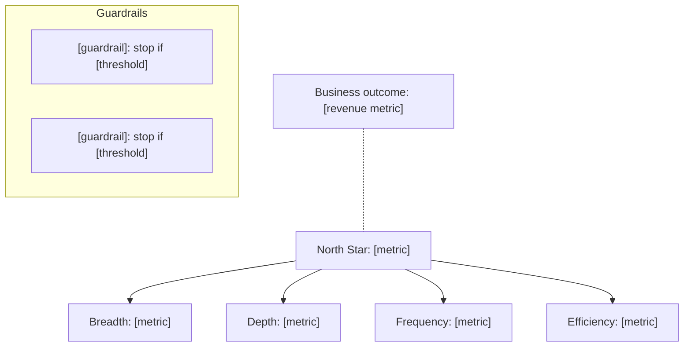
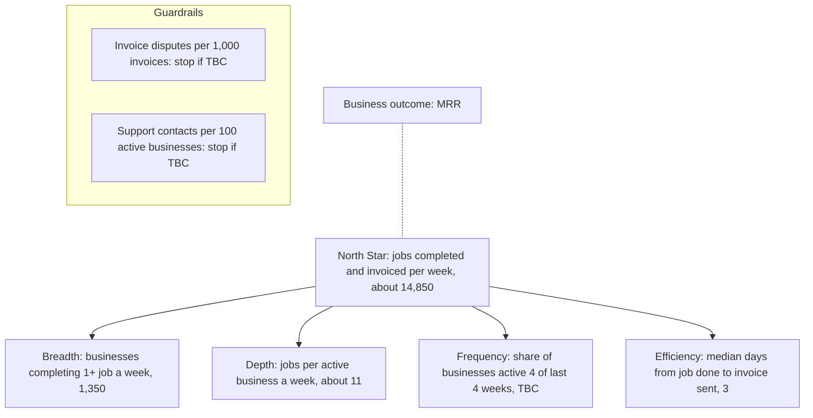

# North Star metric and metrics tree

A metrics tree links what a team can change this week to the one number that shows customers getting value, and from there to revenue. A good one has a North Star a customer would recognise as value, three to five input metrics that teams own and can move, and guardrails that catch the damage when someone pushes too hard.

The usual failure is picking revenue, sign-ups or daily active users as the North Star. Revenue lags and says nothing about why it moved. Sign-ups count interest, not value. Active users count presence. The other failure is a tree of 30 metrics nobody owns.

## Input

What the product does, who pays and how, the metrics tracked today and the tools they live in, and any goals or OKRs. Look for a tracking plan, metric definitions, dashboard exports or an earlier tree in the project with Glob first. If a tree exists, update it and keep the definitions that still hold.

## Ask first when the input is thin

In one message, at most:

1. What does a customer get from the product, in one sentence? At what moment do they get it?
2. Who pays, and how: subscription, per seat, per transaction, ads?
3. What do you measure today, and in which tool?
4. Which teams will own these metrics?
5. Are there goals or OKRs this must line up with?

If the user says "just draft it", propose two or three North Star candidates with [TBC] baselines, recommend one, and list your assumptions.

## Rules

- **Test the North Star against four criteria and show the result.** Pass or fail each one with a sentence.
  1. **Reflects value delivered to customers.** A customer would agree that more of it means they got more out of the product.
  2. **Leads revenue.** When it rises, revenue follows within a few months. With data, check that accounts with more of it retain and expand more.
  3. **Measurable.** It can be computed from data you have, or can start tracking within a few weeks, with a precise definition.
  4. **The team can move it.** Work the team ships in a quarter can change it.
- **Shape it as "[units] that [got value] per [period]".** For example "invoices paid on time per week" or "projects with three or more active collaborators per week". Use a weekly or monthly count, never a cumulative total. A cumulative number only goes up and hides decline.
- **Keep revenue next to the tree, not at the top of it.** Show it as the business outcome the North Star should predict. If someone wants revenue as the North Star, explain this once, plainly: revenue tells you that something changed, the North Star tells you what.
- **Three to five input metrics, covering four kinds.**
  - **Breadth:** how many customers get value (accounts active this week).
  - **Depth:** how much value each one gets (key actions per active account).
  - **Frequency:** how often they come back for it (share of accounts active in 4 of the last 4 weeks).
  - **Efficiency:** how fast or cheaply they get it (median days from sign-up to first value).

  Ideally the North Star is roughly breadth × depth, so you can see which input moved it. An input can have one more level of drivers underneath. Three levels is the maximum.
- **Every input has one owning team,** and should respond within weeks of a change, not quarters.
- **Two to four guardrails.** Things that must not get worse while teams push the inputs: quality (error rate, refunds), customer health (support contacts per 100 accounts, unsubscribes, churn), economics (gross margin, cost to serve). Each has a stop threshold set from its baseline, for example "no more than 10% worse than the 8-week average".
- **Define every metric precisely.** Formula with numerator and denominator, filters (exclude test and internal accounts), time window and time zone, data source (table or event name), one owner, cadence, baseline with its period, and target with a date.
- **Use the baselines the user gives, and never invent one.** Derived numbers are fine when you show the sum ("1,350 × 11 ≈ 14,850"). Missing baselines are [TBC], and "measure the baseline" becomes the first open question.
- **Correlation is a starting point.** If inputs and the North Star moved together in past data, that suggests a link. An experiment confirms it. Say which you have.

## Output

````markdown
# Metrics tree: [product]

**Value in one sentence:** [what customers get]
**North Star:** [metric] · **Business outcome it predicts:** [revenue metric]

## North Star check
| Criterion | Pass? | Why |
|-----------|-------|-----|
| Reflects customer value | Yes / No | [one sentence] |
| Leads revenue | | |
| Measurable | | |
| Team can move it | | |

## Tree


## Definitions
| Metric | Level | Formula | Data source | Owner | Cadence | Baseline | Target |
|--------|-------|---------|-------------|-------|---------|----------|--------|
| [name] | North Star / Input / Guardrail | [numerator ÷ denominator, filters, window] | [table or event] | [team] | Weekly | [value, period] | [value by date] |

## Open questions
- [Question, for example "Measure the baseline for X"] (owner: [name], by [date])
````

After the tree, offer once: "Want me to check the roadmap or a PRD against these inputs, so every item says which one it moves?"

## Example

Input:

```
north star for Fieldnote (job app for small trades businesses: schedule jobs, complete on site, send the invoice). per user per month pricing. last 8 weeks avg: 2,100 paying businesses, 1,350 complete at least one job a week, ~11 jobs per active business a week, median 3 days from job done to invoice sent.
```

Output (excerpt):

````markdown
**Value in one sentence:** tradespeople get jobs done and paid for without paperwork.
**North Star:** jobs completed and invoiced through Fieldnote per week · **Business outcome it predicts:** MRR

## North Star check
| Criterion | Pass? | Why |
|-----------|-------|-----|
| Reflects customer value | Yes | A finished, invoiced job is what the customer is paying us for |
| Leads revenue | Likely | Businesses that run more jobs through us should keep and add users. [TBC: check against retention data] |
| Measurable | Yes | Job completed and invoice sent events already exist |
| Team can move it | Yes | Activation and the job flow both change it within weeks |

## Tree


The North Star baseline is derived: 1,350 businesses × about 11 jobs ≈ 14,850 jobs a week.
````

## Checks before you hand it over

- The North Star is a count of customer value per period, not revenue, sign-ups or a cumulative total.
- All four criteria are tested, each with a sentence.
- The inputs cover breadth, depth, frequency and efficiency, and each has one owner.
- There are two to four guardrails, each with a stop threshold or [TBC].
- Every baseline comes from the input or a shown calculation. The rest are [TBC].
- The Mermaid block uses `flowchart TD`, and every label with punctuation is in double quotes.
