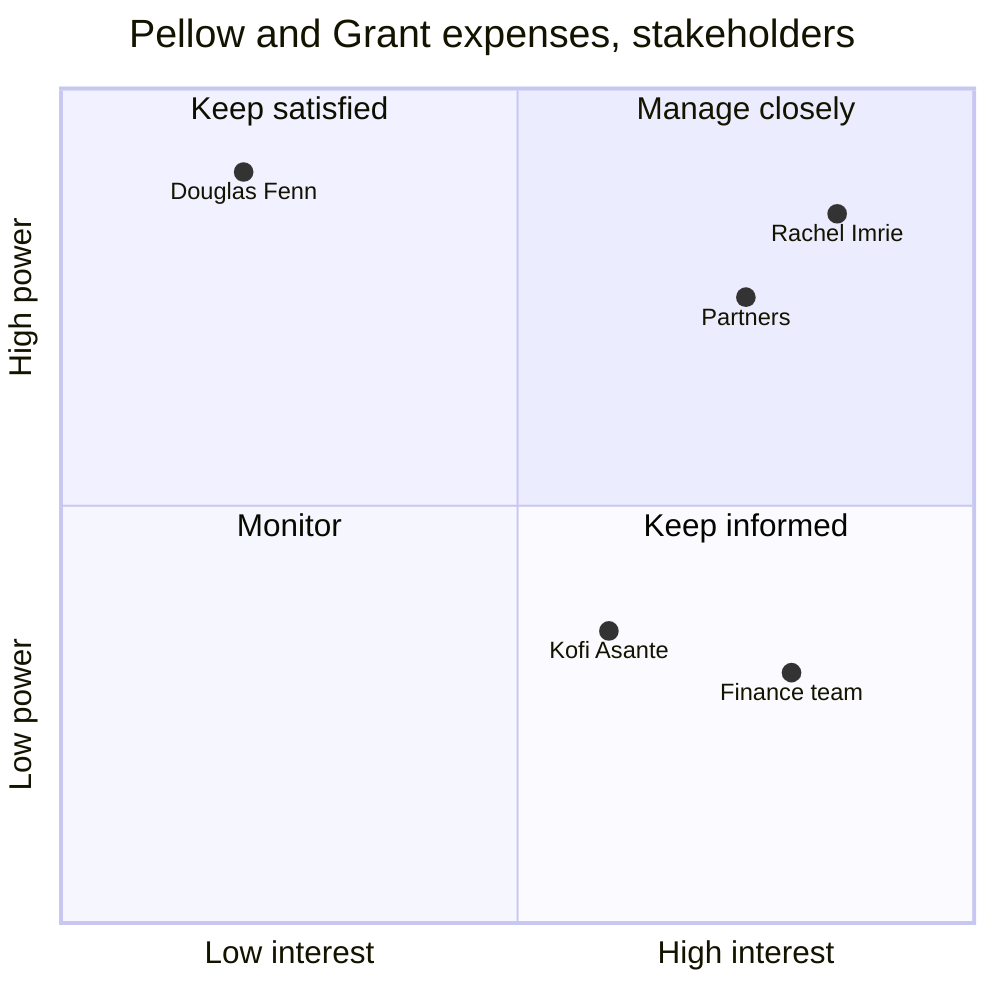

# Stakeholder and communications plan

Stakeholder management is deciding, on purpose, how much attention each person or group gets and what you need them to do differently. A good plan names people rather than departments, says where each one stands today and where the project needs them to be, and turns each gap into an action with an owner and a date.

The usual failure is a list of every department rated "high" with one monthly newsletter for all of them. The second is treating resistance as a communications problem. Resistance usually has a reason, often a fair one, and it needs a conversation, not another email.

## Input

A list of people or groups, an org chart, the charter (sponsor and steering group), and anything the user knows about who said what. Look for an existing register with Glob (`**/*stakeholder*`, `**/*comms*plan*`) and update it rather than start again. Read the charter if there is one.

## Ask first when the input is thin

Ask in one message, at most:

1. What is the project, and what changes for people when it lands?
2. Who decides, who pays, who will use the result, who has to do work for it, and who could block it? Names and roles.
3. Who do you know is for it or against it, and why?
4. Which channels and meetings already exist (steering group, all-hands, team meetings, Teams or Slack channels, newsletters)?
5. Are there dates when people have to act, such as training, cutover or a consultation?

Infer the sponsor and steering group from the charter. Never guess anyone's attitude: write [TBC] and add an action to find out, usually a 20-minute conversation. If the user says "just draft it", build the plan from what you have and list the gaps at the end.

## Rules

- **Name people where it matters.** Groups are fine for large populations ("85 drivers"), but name the person who speaks for them, such as a team lead or a union representative.
- **Power is the ability to change the project's scope, budget, date or outcome:** approving, funding, blocking, or influencing someone who can. Informal influence counts. A depot manager the drivers follow has more power than the org chart shows.
- **Interest is how much the project affects them or how much they care.** Rate power and interest High or Low; use 0 to 1 scores only for the chart.
- **The grid sets the level of attention:**
  - **Manage closely** (high power, high interest): one-to-one contact at least every two weeks, involved before decisions are made.
  - **Keep satisfied** (high power, low interest): short and infrequent, on their terms. One page, not the detail. Make sure they never hear news from someone else first.
  - **Keep informed** (low power, high interest): regular and two-way, with a way to raise concerns. Often the users, and a good early source of risks.
  - **Monitor** (low power, low interest): general updates. Check each review whether they have moved.
- **Record engagement now and where you need it.** Use five levels: Unaware, Resistant, Neutral, Supportive, Leading. Most people only need to be Neutral or Supportive; Leading is for the sponsor and a few champions.
- **Every gap gets an action:** what, who, by when. For resistance, find the reason first: workload, loss of control, a past project that went badly, or a real flaw in the plan. Meet them one to one. If the flaw is real, it goes into the RAID log or a change request.
- **A gap of two or more levels for someone in Manage closely or Keep satisfied is a risk.** Add it to the RAID log (/raid-log).
- **Every message has a purpose.** "Project update" is not a message. "What changes for your team on Mon 1 Mar 2027 and where to get help" is.
- **Pick the channel by quadrant.** Manage closely: meetings. Keep satisfied: a short briefing or one page. Keep informed: demos, drop-ins, a newsletter, a channel for questions. Monitor: intranet or all-staff updates.
- **The right person sends it.** The sponsor sends messages that need authority ("why we are doing this"). Line managers tell their own teams what changes in their jobs. The PM sends progress and logistics.
- **Write what you saw, not what you think of people.** Registers get shared. "Raised cost concerns at the steering group on Tue 10 Nov 2026" is fine. "Difficult" is not. Keep private judgements out of the document.
- **Review monthly and at each stage gate,** and after any reorganisation or scope change. People move.

## Output

````markdown
# Stakeholder plan: [Project]

**Version:** [n], [date] · **Owner:** [PM] · **Next review:** [date]

## Register
| # | Stakeholder | Role | What the project means for them | Power | Interest | Quadrant | Current | Desired | Relationship owner |
|---|-------------|------|---------------------------------|-------|----------|----------|---------|---------|--------------------|

## Power/interest grid
| | Low interest | High interest |
|---|---|---|
| **High power** | Keep satisfied: [names] | Manage closely: [names] |
| **Low power** | Monitor: [names] | Keep informed: [names] |

```mermaid
quadrantChart
    title Stakeholders by power and interest
    x-axis Low interest --> High interest
    y-axis Low power --> High power
    quadrant-1 Manage closely
    quadrant-2 Keep satisfied
    quadrant-3 Monitor
    quadrant-4 Keep informed
    [Name]: [0.8, 0.9]
```

## Engagement gaps and actions
| Stakeholder | Current | Desired | Why the gap | Action | Owner | By |
|-------------|---------|---------|-------------|--------|-------|----|

## Communications plan
| Audience | What they need to know or do | Channel | Frequency | Owner | Starts |
|----------|------------------------------|---------|-----------|-------|--------|

## Open points
- [Attitudes to find out, names to confirm, with who and by when]
````

Include the Mermaid chart when there are three to fifteen points; above that, the table is easier to read. Points take x (interest) and y (power) from 0 to 1. Keep labels short, with no colons or brackets.

## Example

Input:

```
new expenses system at Pellow & Grant (law firm, 300 staff). sponsor is the CFO Rachel Imrie, keen.
managing partner Douglas Fenn signs off anything over 50k, hasn't engaged yet.
partners hate admin and will push back on anything that adds clicks, Anya Rees speaks for them.
finance team (6) will run it, worried about the workload at year end, lead is Ben Cho.
IT (Kofi Asante) does the single sign-on, supportive.
```

Output (excerpt):

````markdown
## Power/interest grid
| | Low interest | High interest |
|---|---|---|
| **High power** | Keep satisfied: Douglas Fenn | Manage closely: Rachel Imrie, partners (Anya Rees) |
| **Low power** | Monitor: none | Keep informed: finance team (Ben Cho), Kofi Asante |



## Engagement gaps and actions
| Stakeholder | Current | Desired | Why the gap | Action | Owner | By |
|-------------|---------|---------|-------------|--------|-------|----|
| Douglas Fenn | Unaware (to confirm) | Supportive | Has not engaged; signs off spend over £50k | 15-minute briefing on the business case before the spend approval | Rachel Imrie | [TBC] |
| Partners | Resistant | Neutral | Expect more admin | Meet Anya Rees; show the submission flow on a phone and count the steps against today's process | [PM] | [TBC] |
| Finance team | Neutral | Supportive | Workload at year end | Agree a go-live date outside year end with Ben Cho | [PM] | [TBC] |

Douglas Fenn is three levels from where he needs to be, and he signs off the spend. Add that to the RAID log as a risk.
````

## Checks before you hand it over

- Every high-power stakeholder is a named person, not only a department.
- Each quadrant gets a different level of attention in the communications plan.
- Every gap has an action with an owner and a date, or [TBC] listed in open points.
- Attitudes are written as observed facts, and none were guessed.
- No person, group or date appears that the user did not give.
