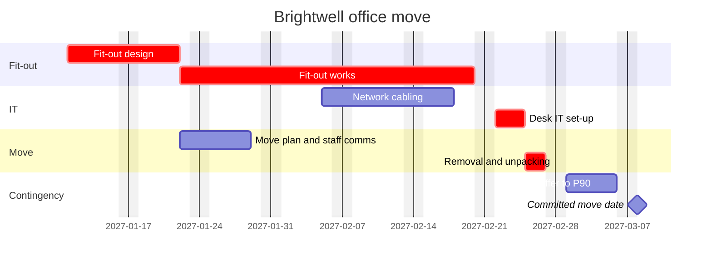

# WBS and schedule

A work breakdown structure (WBS) splits the whole scope into deliverables small enough to estimate, assign and track. The schedule sequences them, says how long the whole thing takes and with what confidence, and shows which chain of work sets the end date. A good one lets the PM answer "if this slips a week, does go-live move?" in ten seconds.

The usual failure is a task list dressed up as a WBS: verbs instead of deliverables, no project management, testing or training branch, single-number estimates, and an end date that is the sum of everyone's best case.

## Input

Scope from a charter or brief, a task list, estimates from the team, a start date and any fixed dates. Read the charter first if there is one (Glob `**/*charter*`): its deliverables are level 2 of the WBS and its milestones are fixed points. If a schedule already exists (`**/*schedule*`, `**/*plan*`, `**/*wbs*`), update it, keep the baseline columns, and say what moved.

## Ask first when the input is thin

Ask in one message, at most:

1. What are the main deliverables, or is there a charter or statement of work I can read?
2. What is the start date, and which dates are fixed (go-live, events, contract ends, change freezes)?
3. Who does the work, and how much of their time is on this project? (Someone at 50% doubles the duration of their tasks.)
4. Do you have estimates from the people doing the work, ideally as best case, likely and worst case?
5. Which public holidays and shutdowns apply, for example 24 Dec to 1 Jan?

Infer a Monday to Friday working week. If the user says "just draft it", draft the WBS and the dependency logic, leave estimates as [TBC], and say that dates and the critical path need the estimates. Never invent a duration.

## How to build it

### The WBS

- **100% rule.** The WBS holds all the work in scope and nothing outside it, and the children of each element add up to exactly their parent. Include project management (planning, reporting, governance) and the unglamorous work: testing, data migration, training, cutover, handover to support.
- **Nouns, not verbs.** Elements are deliverables: "1.3 Supplier contract", not "Negotiate contract". Activities sit under the work package in the schedule.
- **Work packages of 8 to 80 hours of effort, and no longer than one reporting period.** Anything bigger is "80% done" for a month and can't be tracked.
- **Three or four levels** is enough for most projects under 12 months. Number them 1, 1.1, 1.1.1. Organise level 2 by deliverable or phase, not by department.
- **Every work package has one owner.** A supplier can own one; name the supplier's contact.

### Estimates

- **Three-point estimates from the person doing the work:** optimistic (O), most likely (M) and pessimistic (P), in working days.
- **PERT expected duration E = (O + 4M + P) / 6. Standard deviation σ = (P - O) / 6.** Show E to one decimal place and schedule each package at E rounded to the nearest whole day.
- **Challenge narrow ranges.** If P is less than 1.5 × M on work the team has not done before, ask what the worst case really is.
- **Effort is not duration.** 40 hours of effort by someone at 50% availability is 10 working days.

### Dependencies

- **FS (finish to start)** is the default: B starts when A finishes. **SS (start to start):** B can start once A has started. **FF (finish to finish):** B cannot finish before A finishes. Avoid SF; it is almost always a modelling mistake.
- **Lag** is waiting time with no work, such as a 5-day approval window: "FS+5d". **Lead** is overlap: "FS-3d" starts testing 3 days before build ends.
- **No loose ends.** Every package except the first has a predecessor and every package except the last has a successor. Loose ends hide float.
- **External dependencies** (a supplier delivery, another team's API, a sign-off) go in as milestones owned by a named person outside the team, and into the RAID log.

### Critical path

- **Forward pass** gives early start (ES) and early finish (EF). **Backward pass** from the end gives late start (LS) and late finish (LF). Total float = LS - ES. Packages with zero float are the critical path.
- **Show near-critical paths:** anything with 5 working days of float or less. A small slip there creates a new critical path.
- **Check resources.** If one person is on two critical packages at the same time, the logic is wrong. Add a dependency and recalculate.
- Above about 30 work packages, tell the user to calculate in a scheduling tool, and still show the critical path in the output.

### Milestones and contingency

- **Milestones are zero-duration events:** sign-offs, deliveries, go-live. One every 2 to 6 weeks gives the sponsor something to check.
- **Size contingency from the numbers.** Add up E along the critical path for the expected finish, which is roughly a 50% chance (P50). Path σ is the square root of the sum of σ² for the critical packages. E + 0.84σ gives about 80% confidence (P80), and E + 1.28σ about 90% (P90).
- **Plan to the expected date, commit to the P80 or P90 date.** Put the difference in as a buffer before the final milestone, owned by the PM, and say which confidence level you chose.
- **Say where the maths flatters you.** When near-critical paths merge into the critical path, the real chance of hitting the date is lower than the PERT figure. Say so.
- **Working days only.** Exclude weekends and the holidays the user gives. Do not assume a country's public holidays; ask, or list them as [TBC].

## Output

````markdown
# [Project name]: WBS and schedule

**Start:** [date] · **Expected finish (P50):** [date] · **Committed finish (P[80/90]):** [date] · **Buffer:** [n] working days
**Calendar:** Mon to Fri, excluding [holidays] · **Version:** [n], [date]

## Work breakdown structure
- 1 [Project name]
  - 1.1 Project management
  - 1.2 [Deliverable]
    - 1.2.1 [Work package]

## Schedule
| WBS | Work package | Owner | O | M | P | E | σ | Days | Predecessors | Start | Finish | Float |
|-----|--------------|-------|---|---|---|---|---|------|--------------|-------|--------|-------|

## Milestones
| Milestone | Date | Fixed or forecast | Accepted by |
|-----------|------|-------------------|-------------|

## Critical path
[1.2.1 → 1.2.2 → 1.3.2 → M1]: E [n] working days, σ [n] days.
Near-critical: [path], [n] days of float.

## Contingency
P50 [date] · P80 [date] · P90 [date]. Buffer of [n] days before [final milestone], held by [PM].

## Gantt
```mermaid
gantt
    title [Project name]
    dateFormat YYYY-MM-DD
    excludes weekends
    section [Deliverable]
    [Work package]   :crit, wp121, [YYYY-MM-DD], [n]d
    [Work package]   :wp122, after wp121, [n]d
    [Milestone]      :milestone, m1, after wp122, 0d
```

## Assumptions and open points
- [Estimate, resource or date that is not confirmed, with who confirms it by when]
````

Mermaid notes: mark critical packages with `crit`. Mermaid only draws finish-to-start (`after a b` waits for both), so give SS and FF packages an explicit start date and state the link in the schedule table. Add holidays to the `excludes` line, for example `excludes weekends, 2026-12-25`. Task names must not contain a colon or a semicolon.

## Example

Input:

```
office move for Brightwell Accountancy, 40 staff, start mon 11 jan 2027.
best/likely/worst in working days:
fit-out design 5/8/14 (Lina), fit-out works 15/20/32 (Rowan Build) after design,
cabling 6/9/12 (Tomasz) can start 10 days after fit-out works start,
desk IT 2/3/5 (Tomasz) after works and cabling, move plan + comms 3/5/8 (Lina) after design,
removals 2/2/4 (Haulwell) after desk IT and move plan. old lease ends 31 mar.
```

Output (excerpt):

````markdown
**Start:** Mon 11 Jan 2027 · **Expected finish (P50):** Fri 26 Feb 2027 · **Committed finish (P90):** Fri 5 Mar 2027 · **Buffer:** 5 working days

| WBS | Work package | Owner | O | M | P | E | σ | Days | Predecessors | Start | Finish | Float |
|-----|--------------|-------|---|---|---|---|---|------|--------------|-------|--------|-------|
| 1.2.1 | Fit-out design | Lina | 5 | 8 | 14 | 8.5 | 1.5 | 9 | None | Mon 11 Jan | Thu 21 Jan | 0 |
| 1.2.2 | Fit-out works | Rowan Build | 15 | 20 | 32 | 21.2 | 2.8 | 21 | 1.2.1 FS | Fri 22 Jan | Fri 19 Feb | 0 |
| 1.3.1 | Network cabling | Tomasz | 6 | 9 | 12 | 9.0 | 1.0 | 9 | 1.2.2 SS+10d | Fri 5 Feb | Wed 17 Feb | 2 |
| 1.3.2 | Desk IT set-up | Tomasz | 2 | 3 | 5 | 3.2 | 0.5 | 3 | 1.2.2 FS, 1.3.1 FS | Mon 22 Feb | Wed 24 Feb | 0 |
| 1.4.1 | Move plan and staff comms | Lina | 3 | 5 | 8 | 5.2 | 0.8 | 5 | 1.2.1 FS | Fri 22 Jan | Thu 28 Jan | 19 |
| 1.4.2 | Removal and unpacking | Haulwell | 2 | 2 | 4 | 2.3 | 0.3 | 2 | 1.3.2 FS, 1.4.1 FS | Thu 25 Feb | Fri 26 Feb | 0 |

## Critical path
1.2.1 → 1.2.2 → 1.3.2 → 1.4.2: E 35.2 working days, σ 3.3 days.
Near-critical: network cabling has 2 days of float, and Tomasz also owns desk IT set-up. A 3-day slip in cabling moves the end date.

## Contingency
P50 Fri 26 Feb · P80 Wed 3 Mar · P90 Fri 5 Mar 2027. The P90 date leaves 18 working days before the lease ends on Wed 31 Mar 2027 (fewer if public holidays apply: [TBC]).


````

Open points would include project management and old office exit, which are missing from the input and break the 100% rule.

## Checks before you hand it over

- Every WBS element is a noun, project management is included, and anything missing from the input is listed as a gap.
- Every E equals (O + 4M + P) / 6, and the critical path has zero float in the table.
- Every start and finish date is a working day with the right weekday, and FS, SS and FF links match the dates.
- The committed date includes contingency, and the confidence level is stated.
- No duration, owner or holiday was invented.
